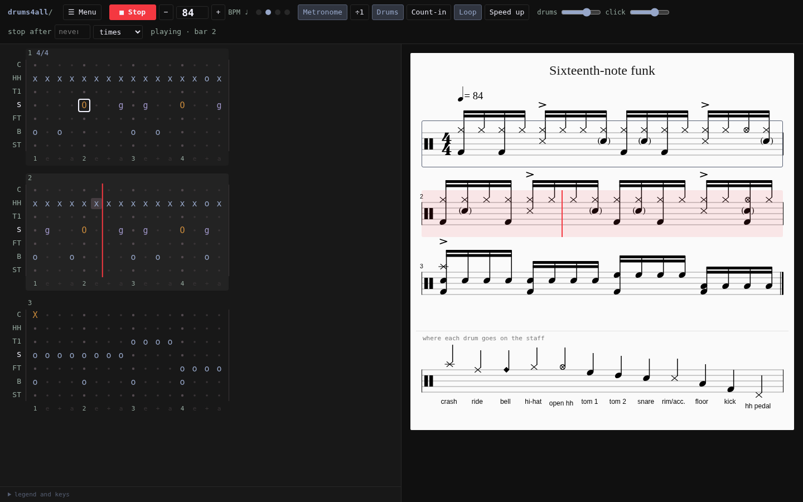
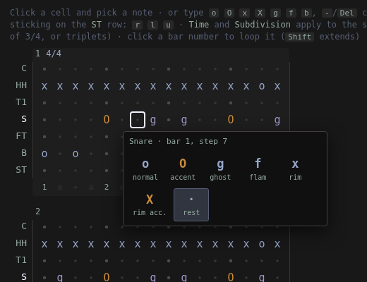
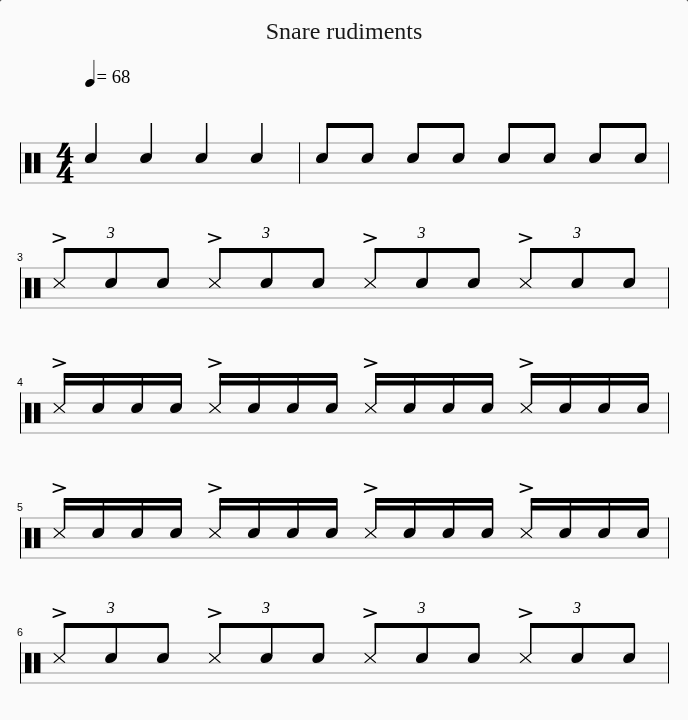

# drums4all

Write drum tabs, see them as sheet music and practice them with a metronome, in the browser.



<p>
  
  
</p>

## Why

I play drums and needed something simple: write a groove or an exercise, see it as sheet music and play along
with a metronome. I couldn't find a simple tool for that. The options were big notation programs like MuseScore,
and learning one of those just to write a few bars of drums didn't make much sense to me. So I made this.

## Credits

drums4all is very much inspired by **[drumtabs.app](https://drumtabs.app/)**: the tab format, the grid editor and
the way the sheet music looks all come from there. Huge props to its developer. If you like this, go use the
original and support its author on [Ko-fi](https://ko-fi.com/treefordev).

## How to use it

You need [Git](https://git-scm.com/downloads) and [Python 3](https://www.python.org/downloads/)
(on Windows, tick **"Add python.exe to PATH"** when installing Python).

```sh
git clone https://github.com/BrunoTeixeira1996/drums4all.git
cd drums4all
```

Then run the start file for your system:

- Linux: `./start.sh`
- macOS: `./start.command` (or double-click it)
- Windows: `start.bat` (or double-click it)

The first start takes a minute. Then the browser opens at <http://127.0.0.1:8484>. Keep that window open while
you use it. Your tabs are saved as `.txt` files in the `tabs` folder. Sub-folders (e.g. `tabs/exercises`) show
up as groups in the tab menu, and **New** can create a tab in one of them.

To open it from a phone or another computer on the same network, start it with `./start.sh --host 0.0.0.0` and go
to `http://<computer-ip>:8484`.

## What it does

- Grid on the left, sheet music on the right. Click a cell and pick the note (accent, ghost, flam, rim, open
  hi-hat…), or type it.
- Sticking (`R`, `L`, `U` for both hands) under the notes.
- Any time signature and subdivision per bar (a single 3/4 bar, triplets, 16ths…).
- Real recorded drum kits, and a metronome with count-in, loop and automatic speed up.
- Stop by itself after N times through the tab, or after N minutes.
- Each tab remembers the BPM you last practised it at.
- Export to PDF, MIDI, WAV and `.txt`.

Press `Space` to play or stop. Hover the buttons to see their keyboard shortcuts.

## Tab format

```
Title: Basic rock
Tempo: 90

HH|x-x-x-x-x-x-x-x-|
 S|----o-------o---|
 B|o-------o-o-----|
```

One line per instrument (`C` crash, `R` ride, `HH` hi-hat, `HF` hi-hat pedal, `T1` `T2` toms, `S` snare,
`FT` floor tom, `B` bass drum), `|` between bars, one character per step. `o`/`x` is a note, upper case is an
accent, `g` ghost, `f` flam, `-` rest. Tabs copied from drumtabs.app can be pasted with the `Text` button.

## Running it by hand

```sh
python3 -m venv .venv
.venv/bin/pip install -r requirements.txt
.venv/bin/python app.py      # http://127.0.0.1:8484
```

## Third-party material

- Drum samples:
  - Pearl and Tama kits: AVL Drumkits *Black Pearl 2023* and *Blonde Bop* by Glen MacArthur, CC BY-SA.
  - GM Rock kit: Hydrogen *GMRockKit* by Glen MacArthur / Sebastian Moors, GPL.
- [VexFlow](https://www.vexflow.com/) 4.2.3 (MIT), [jsPDF](https://github.com/parallax/jsPDF) 2.5.1 (MIT),
  [svg2pdf.js](https://github.com/yWorks/svg2pdf.js) 2.2.3 (MIT).
